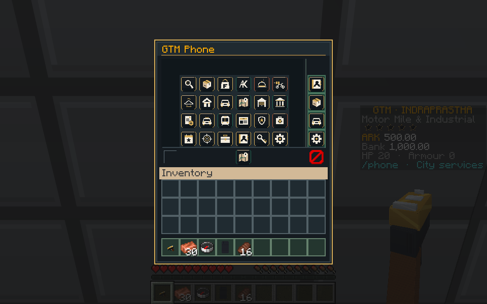
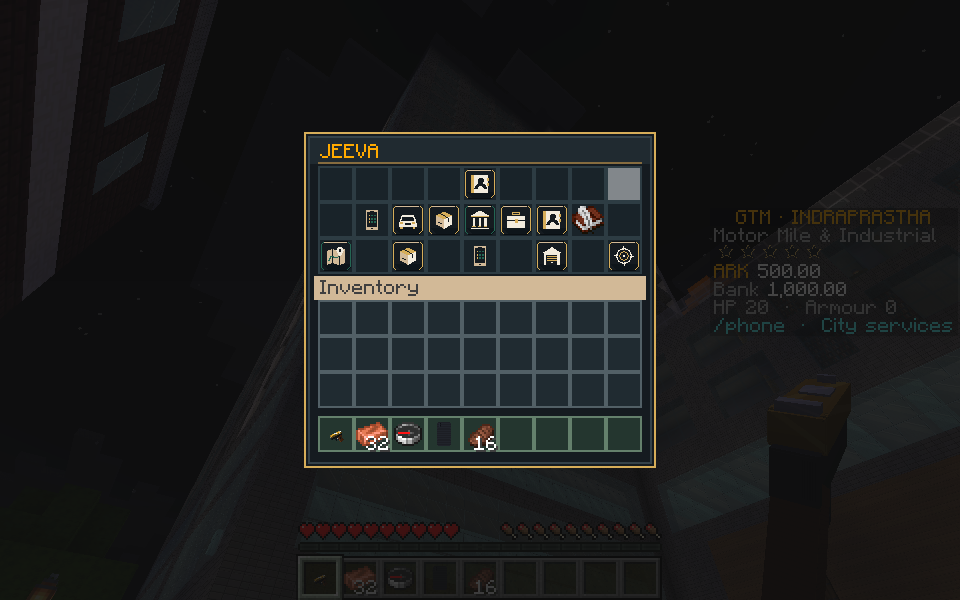
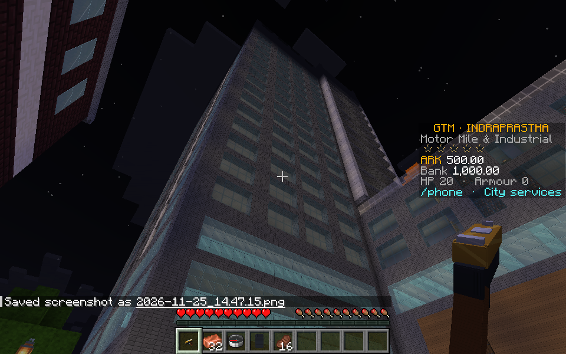
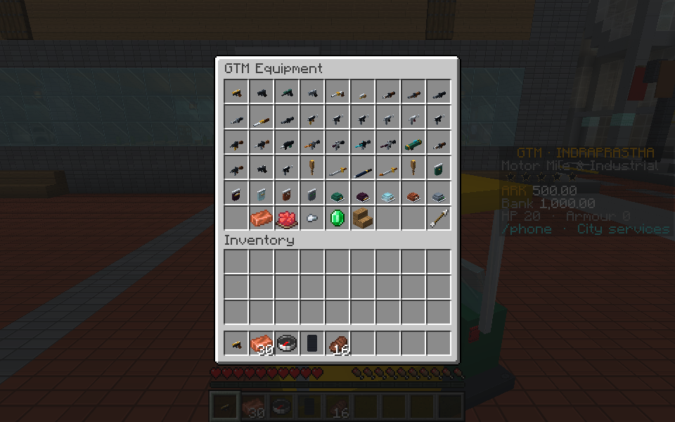
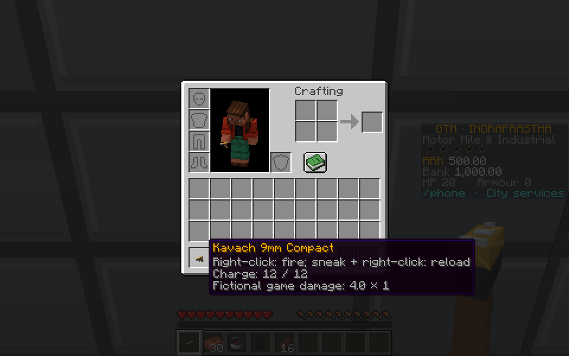
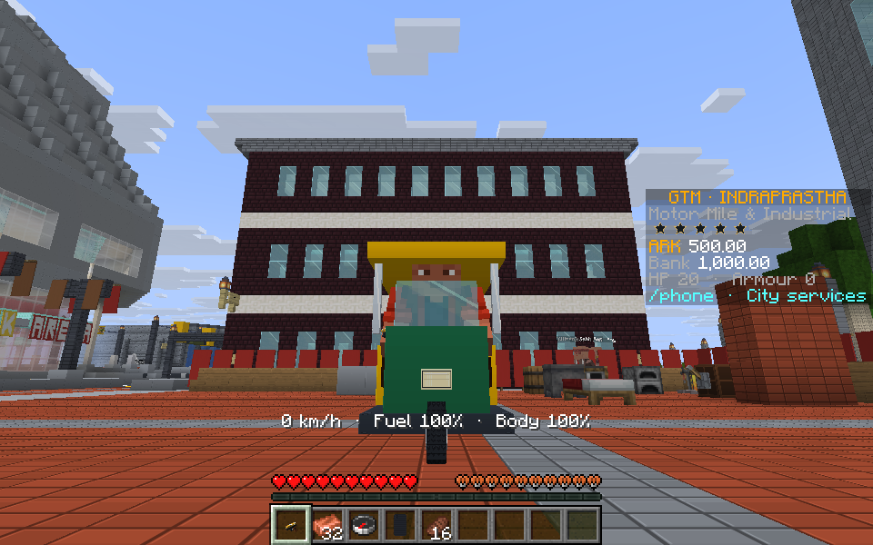
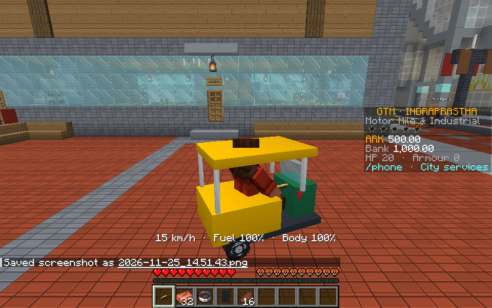
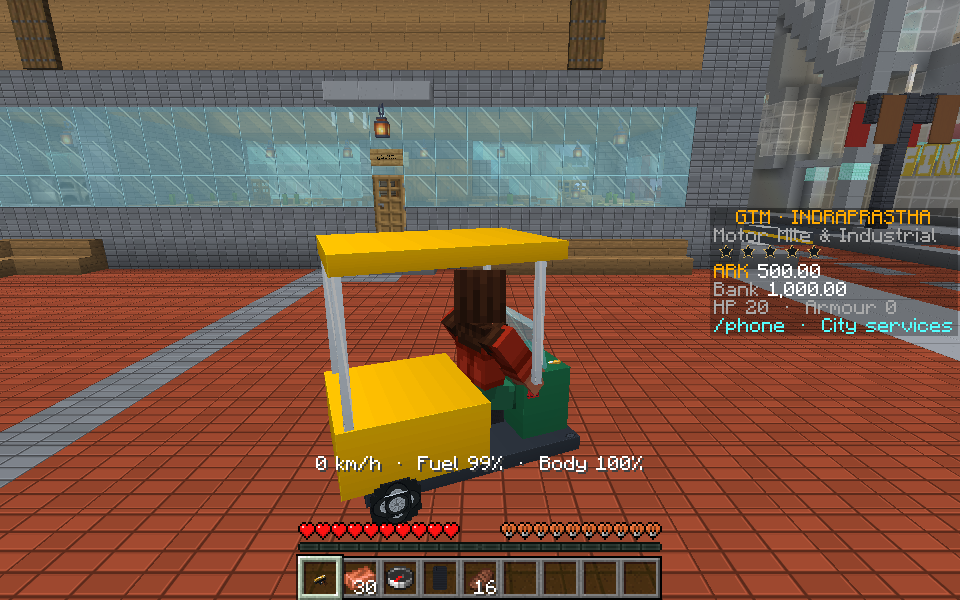

# GTM runtime repair — 25 November 2026

## Status and intended installation

**Java-tested repair candidate — 25 November 2026.** This repair produces a real installable update, `GTM_Runtime_Repair_1.0.4.zip`, for an existing `1.0.3-r4-functional-candidate` server. Source compilation, regression tests, the running server's HTTP console and update/rollback checks have passed. The actual Minecraft 26.3 client shows the custom phone and icons, JEEVA submenu and held native pistol after ordinary login. Firing, reloading, safe-area restrictions, driving controls and grounded wheel animation have passed a native smoke test. The traditional rickshaw canopy has been raised to provide measured player clearance, with corresponding collision bounds and regression checks. The final exact-byte restart confirmed normal-login phone and equipment rendering, grounded wheels and the driver beneath the repaired canopy. Native Bedrock acceptance is outstanding.

The update contains a patched `SDCraftCore-1.0.4-r4-repair.jar`, matching Java and Bedrock resource packs, Geyser mappings, the verified updater, and the Control Centre opener. It uses the existing server, worlds, accounts and launcher. It does not supply a replacement city save or require an account reset. The supported server profile uses Java 25 and Paper/Minecraft 26.3. See the [short installation guide](../packaging/repair/README.md) and [release acceptance notes](../packaging/repair/RELEASE_NOTES.md).

## What caused the visible failures

### Phone icons and custom interface

The configured public download and the actual runtime were out of step. The earlier active `EXPECT_SDCRAFT_ResourcePack_26.3.zip` had SHA-1 `cd6420c2d685069df42dd88f7903363a6c24632b`. It did not contain the new `gtm` phone app definitions used by the recovered runtime. The repaired pack is assembled from the fingerprinted functional payload and checked against the plugin's actual `ui/catalog.tsv`, including all 24 phone apps and 57 runtime UI items. [Pack builder and binding checks](../tools/build_repaired_packs.py)

The first real Minecraft 26.3 test exposed a second defect: the UI, finish and outfit PNGs existed in the pack, but their directories were absent from the item texture atlas. File-existence checks alone had passed. Minecraft logged missing textures for `gtm:ui/app_bank`, other phone apps, finishes and outfits. The revised builder registers the required atlas sources and removes an inherited blocks-atlas override that duplicated item sprites. Regression tests now reject an existing PNG that is absent from the effective item/block atlas, as well as duplicate registration. [Pack regressions](../tools/test_repaired_packs.py)

A separate pack-ready issue prevented the phone skin from activating after the normal login-phase download. In the first native test, `/pack` produced the play-phase acknowledgement and immediately activated the dark/gold skin. The main plugin now checks the player's inherited resource-pack status on join as well as later status events. The next real-client test confirmed ordinary login activates the interface without this manual resend. [Pack-ready and welcome wiring](../hotfix/src/main/java/com/sdcraft/core/SDCraftCorePlugin.java)

### Weapons

The latest runtime already contained native firearm behavior and artwork, but the starter kit favored QualityArmory, non-firearm catalogue entries preceded the firearms, and the old administrator menu reused four generic types under unrelated labels. Some old ammunition tags also did not match their reload engine. The repair routes normal equipment access to the native catalogue, puts firearms first, supplies matching ammunition and preserves authored finishes. The client additionally showed the original first-person pose almost entirely below the screen; only the first-person display transforms are adjusted, leaving the mesh, textures and inventory preview intact. [Weapon implementation and evidence](../hotfix/WEAPONS.md)

### Vehicles

The preserved vehicle adapter did not compensate for the client's additional `ItemDisplay` Y rotation. For the traditional auto, this made the front wheel orbit its authored pivot and rise above the roof during animation. The repair applies the inverse rotation at the two checked render-transform call sites. The road controller also receives revised acceleration, braking, coasting, turning and fuel accounting. An elevated native-client view exposed a separate canopy-clearance defect: the seated player's head intersected the roof. The traditional auto canopy is now 0.45 blocks higher with its four posts extended, and its collision profile encloses the repaired geometry. The bounded change covers normal, damaged and critical variants in six Java models and twelve Bedrock geometries; seats, wheels, texture bytes and the other 86 profiles are unchanged. [Vehicle explanation and mathematical tests](../hotfix/VEHICLE_REPAIR.md)

## What is available in the repaired game

### Phone, HUD and JEEVA

Open the phone item or use `/phone`. The repaired Java phone provides a dark/gold container skin, the existing 24 native128 app icons, and shortcuts for JEEVA, equipment, garage and settings. The skin is attached to the actual inventory and its existing click handlers. Page controls remain session-bound; closing or replacing a screen invalidates its old actions. [Phone implementation](../hotfix/src/main/java/com/sdcraft/core/GtmPhoneApps.java)

After authentication and a successful matching pack load, the welcome flow can open the phone once for the player's saved repair receipt. Reconnecting does not repeatedly reopen it. Existing feature flags and permissions still apply. The HUD uses a compact sidebar for district, wanted level, wallet, bank, health and armour, plus a short driving readout when relevant. It does not repeatedly overwrite the on-foot weapon ammunition readout. [HUD implementation](../hotfix/src/main/java/com/sdcraft/core/GtmPhoneHud.java)

JEEVA offers clickable help topics and a private question route. It can explain driving, weapons, banking and city services using the implemented local guide and available player state. This is the offline fallback, with no paid AI dependency. It is not represented as an unrestricted external generative model. [Local assistant](../hotfix/src/main/java/com/sdcraft/core/GtmPhoneAssistant.java)

The Java interface uses the ordinary client's inventory, sidebar and resource-pack font facilities. It does not replace Minecraft's complete client UI or hide the player's inventory and hotbar. Bedrock uses its native inventory fallback; Java's custom font background is not presented as a native Bedrock screen.

### Guns and ammunition

| Action | Command or control |
| --- | --- |
| Open the native equipment catalogue | `/gun` or `/equipment` |
| Review an item and its purchase confirmation | Click it in the catalogue |
| Fire the held gun | Right-click |
| Reload with matching ammunition | Sneak + right-click |
| Apply a supported native finish | `/gtmfinish` while holding compatible equipment |
| Open administrator equipment previews | `/arsenal`, with administrator permission |

Existing authenticated players can receive the once-only native Kavach service pistol. A full inventory defers the delivery until space is available and the player uses `/gun` or logs in again. The item and entitlement marker are saved together; existing items and balances are retained. The owner may disable this optional grant with `equipment.repair-starter: false`. QualityArmory possessions are not silently converted. [Upgrade behavior and tests](../hotfix/WEAPONS.md)

The four-family fallback engine retains its original base materials and metadata while using explicit `gtm:core_pistol`, `gtm:core_shotgun`, `gtm:core_smg` and `gtm:core_rifle` aliases in the matching packs. Stable item identities and original equipment values are retained. Static model resolution is distinct from native-client combat and presentation checks.

### Driving

Use `/car` for the existing garage and vehicle controls. Releasing the throttle retains momentum and then coasts down; applying opposite throttle brakes to a stop before reversing. Steering remains responsive at low speed and is bounded at higher speed. An empty or failed engine cannot add speed, but existing momentum and brakes continue to work. Accepted collision travel determines fuel and odometer updates. Saved ownership, seat definitions, model identities and world positions are retained. Rail and ropeway callers retain their original proposal contract. [Road repair](../hotfix/VEHICLE_REPAIR.md)

The vehicle tests exercise analytic distances, timestep consistency, turning, fuel/collision accounting, all 87 bundled profiles, all 65 road profiles, and a curved route through the preserved fleet controller. They do not replace a native driving session on the user's laptop or a complete road-collision survey.

## Install the repair

### Existing laptop server

Use Python **3.10 or newer** for the updater. Keep the server's existing Java 25 runtime and launcher. Extract the entire repair ZIP into a separate folder, stop Paper and its launcher, then run one of these commands from the extracted repair folder:

```bat
Update-GTM.bat "C:\path\to\existing\GTM-server"
```

```bash
sh Update-GTM.sh /path/to/existing/GTM-server
```

The commands above update Java, the verified client path. For an existing Geyser installation, append `--bedrock` to also update its pack and mappings. This optional flag does not enable disabled features or install a missing Geyser runtime; native Bedrock testing remains outstanding.

The updater verifies the manifest, plugin identity, supported base fingerprint, each file's size and SHA-256, and the Java pack's SHA-1 and ID before making changes. It acquires the world session locks and checks the configured local gameplay and launcher ports. Unknown core binaries, unsafe paths, symlinks, an incomplete earlier transaction or a running server stop the operation. [Updater](../tools/install_runtime_repair.py)

On success, the command prints a backup ID. Keep it. Start the server through its existing launcher, connect and allow the matching resource pack to finish loading. The repaired portable profile keeps the local pack endpoint and updates `resource.pack`, the checksum, and `launcher/integrity.sha256` so the verified launcher can still start. Unrelated checksums and settings are retained.

### Existing Daytona server

The repair ZIP can be transferred and extracted separately on the existing host. With that server stopped, run the installer against the explicit existing server directory:

```bash
python3 /home/daytona/repair/install_runtime_repair.py apply \
  --payload /home/daytona/repair \
  --server /home/daytona/sdcraft_server
```

Adjust the paths to the actual extraction and server directories. This example updates Java only. Append `--bedrock` if the server already has Geyser and you also want the optional Bedrock pack and mapping update. The repair uses its published, versioned Java pack URL when there is no local portable launcher. The updater itself does not contact Daytona, start or stop a server, or change network access. Deployment to the user's existing host remains separate from the isolated staging results.

## Open the actual Control Centre

The repaired plugin starts its local HTTP Control Centre on `127.0.0.1:8765` by default. It shows current server version, tick performance, memory, players, authentication and pack-loading status, loaded worlds, enabled features and recent logs. Its command interface dispatches server commands through Paper's main thread and records a bounded outcome. The guide answers locally. [Server implementation](../hotfix/src/main/java/com/sdcraft/core/GtmWebConsole.java)

After starting a repaired local server, run **Open-Control-Centre.bat inside that server folder**, or:

```bash
python3 /path/to/existing/GTM-server/tools/open_control_centre.py \
  --server /path/to/existing/GTM-server
```

An authenticated administrator playing on the same computer can also use `/gtmweb`. The opener reads the owner's local token, checks that the server is ready and opens the browser. The token is private and changes when the console restarts. API access requires it; the listener is bound to loopback. Lifecycle-changing commands require explicit confirmation in the console. [Console HTTP evidence](repair-evidence/console-http.json)

For an already repaired and running Daytona server, use the updated GitHub checkout and the existing Daytona access settings:

```bash
python tools/open_control_centre.py --daytona
```

The default remote directory is `/home/daytona/sdcraft_server`; specify `--remote-root /actual/server/path` if it differs. The tool creates an SSH forward from local loopback to the remote loopback console. Keep its terminal open while using the dashboard. Ctrl+C closes this console connection and leaves the game running. The update-only package supplies the local opener; Daytona mode requires the repository's `tools/daytona_tunnel.py`. [Opener implementation](../tools/open_control_centre.py)

If the configured console port differs, pass the same value with `--port`. `--check` verifies access without opening a browser. The normal local URL alone cannot control a remote Daytona server without this tunnel.

## Rollback and preservation

Before replacement, the updater backs up every changed existing file and stages the verified new bytes. The transaction receipt records the original and replacement hashes. Ordinary replacement failure triggers automatic restoration. An interrupted process leaves a prepared receipt; a subsequent apply refuses to proceed until that transaction is recovered. [Transaction regressions](../tools/test_install_runtime_repair.py)

Stop Paper and its launcher, then restore the backup printed by the update:

```bat
Update-GTM.bat "C:\path\to\existing\GTM-server" --rollback BACKUP_ID
```

```bash
sh Update-GTM.sh /path/to/existing/GTM-server --rollback BACKUP_ID
```

The equivalent direct command is:

```bash
python3 install_runtime_repair.py rollback \
  --server /path/to/existing/GTM-server --backup BACKUP_ID
```

Rollback restores the changed binaries, packs and pack-delivery settings, removing files newly added by this transaction. It does not restore an old world save or reset accounts. To protect later work, it refuses to overwrite a target edited since installation; this includes `server.properties`. The receipt and backed-up originals remain available for review if a later server run or owner edit has changed that file.

## Source provenance and reproducible build

The repository's historical `source/` tree is older than the actual shipped 1.0.3 runtime. This repair therefore uses the immutable owner-provided binary under `runtime/functional-r4/` as an explicit input. The supported core SHA-256 is:

```text
b7c76cd3a664e1bb7e1e56fd2098f7ef0a71e921d47170ed10c4e658974715af
```

Selected adapter classes were reconstructed with CFR, reviewed, corrected to compile, and maintained under `hotfix/`. Shared road physics is maintained against the preserved public API. The vehicle adapter itself retains its original bytecode except for exactly two checked matrix-transform calls. The transformer rejects changed, corrupt or already-patched input. Untouched runtime entries are retained, and the release builder reports which top-level classes were replaced. This is a maintained overlay, not a claim that the missing original source was recovered. [Build recipe](../hotfix/build.gradle.kts), [release assembler](../tools/build_repair_release.py), [vehicle patch](../hotfix/tools/PatchVehicleBytecode.java)

With Java 25, Gradle 9.2.1 and the pinned Python dependencies available:

```bash
python -m pip install -r tools/requirements-gtm128.txt
gradle -p hotfix --no-daemon clean check jar patchVehicle
python -m unittest discover -s tools -p 'test_repaired_packs.py' -v
python -m unittest discover -s tools -p 'test_rickshaw_canopy.py' -v
python -m unittest discover -s tools -p 'test_install_runtime_repair.py' -v
python tools/build_repaired_packs.py
python tools/build_repair_release.py \
  --overlay hotfix/build/libs/GTM-Repair-Classes-1.0.4-r4-repair-overlay.jar \
  --vehicle-class hotfix/build/vehicle-patch/com/sdcraft/core/GtmVehicles.class
python tools/package_repair_candidate.py
```

The independent [GitHub Actions build](https://github.com/dev351en/gtm/actions/runs/45638152091) completed this full Gradle check/build/patch sequence, the pack, updater and publication tests, and candidate-artifact packaging. Its core and pack matched the local inputs at that checkpoint. This successful run preceded the final bounded canopy repair; the additional local tests and final target hashes below cover that change. The final source commit must pass the same independent workflow, including the new canopy tests, before publication. The earlier successful run is evidence for that checkpoint, not a claim that CI has already verified the later files. [CI evidence](repair-evidence/github-ci.json)

The pack builder reconstructs the preserved inputs from their checked repository parts. It retains the native128 artwork and stable IDs, adds the inventory compatibility skins and weapon aliases, repairs atlas registration and the malformed inherited backup model, adjusts the specified gun hand-pose metadata, and applies the bounded traditional-rickshaw canopy repair. It writes separate outputs and never changes the preserved functional payload. The compiled overlay JAR is a build input; install the assembled `SDCraftCore-1.0.4-r4-repair.jar`, not the overlay by itself.

## Verification evidence and remaining limits

### Observed native Java result

The official Minecraft 26.3 client connected to the isolated repaired Paper server, completed the normal account login, and displayed the custom phone skin and every app icon. JEEVA opened a styled submenu, and the held Kavach model was fully visible. The inventory retained exactly one pistol and 32 rounds after the restart/login cycle. The corresponding resource reload logged zero missing-model-texture and zero duplicate-sprite warnings.

These are original F2 screenshots from that client, copied without image editing. The phone, equipment catalogue and canopy images show the final exact pack; the JEEVA, held-weapon, reload and driving images record the earlier successful gameplay checks:









The subsequent native gameplay check observed firing outside the inspected spawn safe zone, reloading with the matching ammunition and rejection of firing within that safe zone. The first shot displayed 11/12 rounds; the final reload tooltip displayed 12/12 and 30 reserve rounds after the complete two-shot input sequence. It did not test target-damage balance or combat accuracy. [Native Java record](repair-evidence/native-java.json)



The owned rickshaw accelerated to an observed 14 km/h, steered while moving at 15 km/h, reversed at 9 km/h, braked to zero and allowed the player to dismount. Fuel decreased to 99%; body health remained 100%. The front wheel stayed below the body at ground level after rotation. This was a local smoke test, not a survey of every model, road, slope or collision condition. [Native Java record](repair-evidence/native-java.json)





An elevated side view separately exposed the driver's head clipping the canopy. The implemented 0.45-block canopy lift and extended posts provide measured clearance for the preserved driver and rear-seat positions through the bounded pitch range; the smallest calculated helmet clearance is approximately 0.027 blocks. The matching runtime profile now encloses the roof at a maximum Y of 2.238. Seven geometry regressions guard the exact input fingerprints, the permitted changes, display bounds and profile agreement. The final native-client side view confirmed the driver beneath the repaired roof, with the wheels still grounded. [Clearance calculation](repair-evidence/canopy-clearance.json), [geometry tests](../tools/test_rickshaw_canopy.py)



The final pack also repairs missing commas in an unused inherited ammo backup model, preserving its ten IDs and model targets. All included model JSON is parsed during validation. The final exact-byte restart completed successfully. The server used core `cd7db28…`, and the client downloaded and rendered Java pack `03b6d50…`; the cached pack SHA-1 was verified. Its final pack reload logged zero missing-model-texture warnings, zero duplicate-sprite warnings and zero model-load failures. Full fingerprints appear below. [Final native smoke record](repair-evidence/native-java.json)

### Executed checks

| Check | Executed result | Evidence |
| --- | --- | --- |
| Independent GitHub Actions build | Full Gradle clean/check/JAR/patch, Python checks and installable artifact succeeded for the preceding checkpoint; final canopy-inclusive publication is gated on a fresh run | [CI report](repair-evidence/github-ci.json), [workflow run](https://github.com/dev351en/gtm/actions/runs/45638152091) |
| Java compilation and JUnit | 53 passed, including 24 vehicle tests; zero failures, errors or skipped tests | [Java report](repair-evidence/java-unit-tests.json) |
| Vehicle transformer | Five strict input/call-site/repeat checks passed | [Java report](repair-evidence/java-unit-tests.json), [vehicle notes](../hotfix/VEHICLE_REPAIR.md) |
| Original equipment compatibility | 826 assertions across 133 records and derived behavior | [Java report](repair-evidence/java-unit-tests.json), [weapon notes](../hotfix/WEAPONS.md) |
| Resource pack regressions | 12 passed, including item-atlas reachability and every included model JSON | [Pack tests](../tools/test_repaired_packs.py); generated `pack-repair-report.json` |
| Traditional-rickshaw canopy repair | Seven passed; guarded geometry changes, driver/rear-seat clearance, culling bounds and runtime profile agreement | [Canopy tests](../tools/test_rickshaw_canopy.py), [clearance report](repair-evidence/canopy-clearance.json) |
| Updater regressions | 22 passed, including real process-held locks and shell execution | [Updater tests](../tools/test_install_runtime_repair.py) |
| Publication fixtures | 17 passed, including target and asset fingerprint guards | [Publication tests](../tools/test_repair_publication.py) |
| Final portable install/rollback | Final target bytes installed through the shipped CLI; existing launcher check passed; all 1,013 original files restored exactly | [Integration report](repair-evidence/installer-integration.json) |
| Running Paper HTTP console | 23 of 23 checks passed | [HTTP report](repair-evidence/console-http.json) |
| Native browser console view | Actual sign-in page displayed; authenticated browser layout remains unverified | [Console verification](../hotfix/CONSOLE_VERIFICATION.md) |
| Native Java client UI | Normal login, custom phone and all icons, JEEVA submenu, visible held pistol and no duplicate repair grant observed; final exact bytes rechecked for phone, catalogue and canopy | Original F2 screenshots above and [native Java record](repair-evidence/native-java.json) |
| Native Java weapons and driving | Fire/reload, safe-area refusal, acceleration/steering/braking/reverse/dismount and grounded wheel observed | [Native Java record](repair-evidence/native-java.json); final reconnect also verified repaired canopy clearance |
| Native Bedrock client | Not completed | No Bedrock gameplay acceptance claim |
| User's Daytona deployment | Not performed by these checks | Isolated staging only |

The full portable-bundle integration was repeated against the final canopy-inclusive target core and pack hashes below. It exercised the shipped updater CLI with Bedrock file updates enabled, the existing launcher's Java-only preflight, and explicit rollback. All 1,013 original bundle files and the two existing coordination-lock files matched the pre-update baseline after rollback. This establishes installation, preservation and launcher compatibility for those bytes; completed gameplay observations are recorded separately.

### Final candidate fingerprints

These identify the exact payload verified by the full portable-bundle installation and rollback. The manifest also records sizes, installation paths and the pack UUID.

| File | SHA-256 |
| --- | --- |
| `SDCraftCore-1.0.4-r4-repair.jar` | `cd7db28cf7959e5c0801507c647479ebffca67616a8c543333ce24c8051ad5ac` |
| `GTM_Repair_128_Java.zip` | `03b6d50e96c09643b289cb4a5afd6d6aea0830267e0bf174336f8d6269e9022e` |
| `GTM_Repair_128_Bedrock.mcpack` | `1595eb5f9b487b7528c933ecc46f0e7ad5182d268e1d62f5ddb1c342599d2eba` |

The Java pack SHA-1 used by Minecraft is `6c18645d1ee9f41daa132ef82c61f3dd8b1d2390`. [Exact-byte installation report](repair-evidence/installer-integration.json)

The test sandbox cannot satisfy the preserved NetherNet launcher's requirement for an active private LAN IPv4 interface. Java-only launcher validation succeeded. Windows wrapper execution, the Windows lock branch, native Bedrock appearance and controls, and laptop driving feel remain separate checks. Audio acceptance was unavailable because the isolated client has no OpenAL output device. Generated contact sheets and layout previews are not client screenshots or gameplay evidence.

Each downloadable release includes its manifest, `SHA256SUMS`, `build-report.json`, `pack-repair-report.json` and selected verification evidence. Those records identify the actual assembled files. The Java candidate has the native acceptance evidence described above. Bedrock, Windows execution and deployment to the existing live host retain the stated limits.
