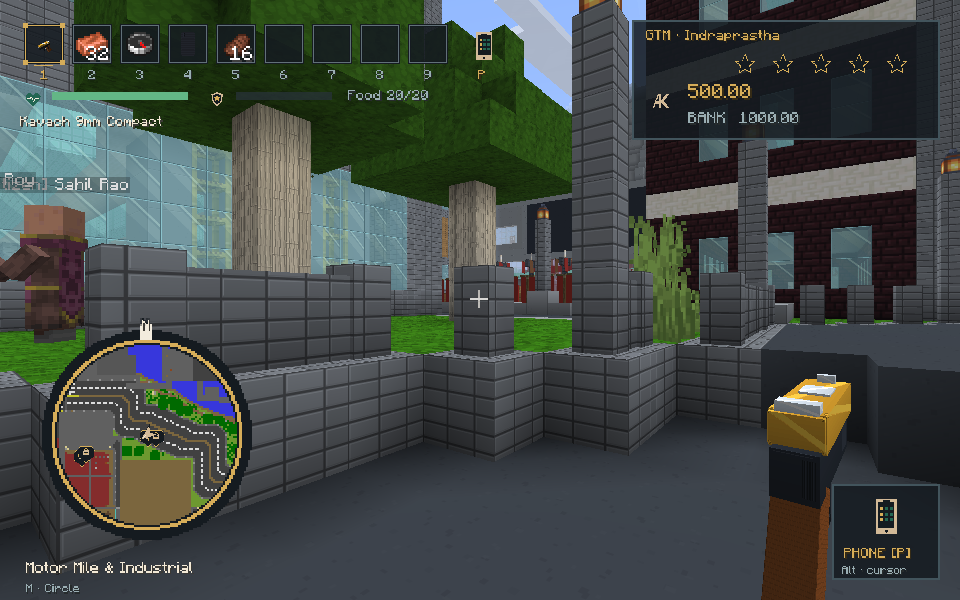
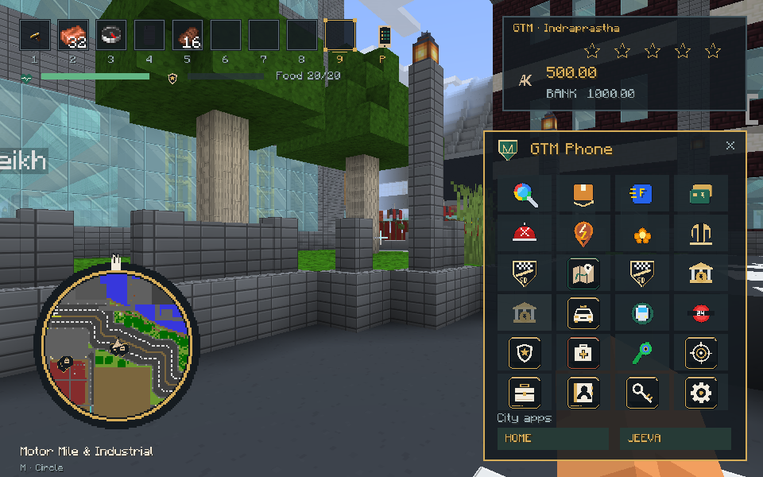

# Approved HUD, NPC and passenger recovery — 25 November 2026

## What was wrong

The earlier 1.0.4 repair corrected broken resource references and added an inventory phone skin, but it did not implement the approved HUD. A dark inventory window, sidebar and generated preview were not substitutes for the requested top-left inventory, bottom-left map, top-right wanted/cash/bank and bottom-right clickable phone. This record supersedes that UI acceptance claim. The [1.0.4 report](RUNTIME_REPAIR_2026-11-25.md) remains historical evidence for its exact bytes.

The user also identified incorrect auto capacity and NPCs that crowded the world without conversation or defensive behavior. Inspection found concrete causes: a dialogue flag and permission that ordinary players could not use; an ambient greeting path disconnected from conversational UI; no Paper navigation fallback without Citizens; population caps applied only to one roster mode; missing persistent ownership/reconciliation; and weapon target gates treating Citizens player-shaped NPCs as unauthenticated real players.

This candidate implements the requested Java HUD and repairs those runtime paths. It does not certify the complete Revision 4 city, every vehicle interior, Bedrock HUD, or a connected generative model.

## Four-corner Java HUD

The implementation is in [client-hud](../client-hud/README.md), with the authenticated bridge in [GtmClientHud.java](../hotfix/src/main/java/com/sdcraft/core/GtmClientHud.java).

| Requested behavior | Implementation and practical limit |
| --- | --- |
| Top-left inventory | Nine actual hotbar items, counts, selected slot and held-item behavior. The full carried inventory remains accessible normally. |
| Bottom-left map | Loaded-terrain minimap with circle/rectangle modes and available commissioned-service markers. It is not a fabricated map image or an unexplored-world oracle. |
| Top-right stars and money | Server wanted level, wallet and bank. Client-supplied numbers have no financial authority. |
| Lower-right phone | Persistent shortcut and a non-pausing popup. `/phone` and real phone-item use route to that popup when the client component is active. |
| Original app logos | The earlier colourful brand PNGs are copied byte-for-byte. Existing native128 HUD and service art is retained. No replacement logos were generated. |
| App actions | Existing app registry, access gates and service routes. Detailed transactional screens can hand off to the existing server inventory UI. |
| Vehicle instruments | Real driving speed, energy/body and occupied-seat data, when supplied by the active vehicle. |

The project specification retains **no mandatory client mods**. Ordinary Java access is preserved. The exact movable hotbar, terrain map and clickable overlay use an **optional Fabric client**; a vanilla Java resource pack does not provide that arbitrary input/rendering capability. This is an explicit platform distinction. The component targets the actual Minecraft 26.3 client, Java 25, Loader 0.20.1 and API 0.167.0+26.3. Its build downloads pinned official inputs and never redistributes Minecraft binaries. See the [Fabric HUD API](https://docs.fabricmc.net/develop/rendering/hud).

### Session and action boundaries

The bridge uses `gtm:hud_hello`, `gtm:hud_state` and `gtm:hud_action` with bounded UTF-8 JSON. A capability hello is not authentication. Active state requires the current authenticated login, phone access, successful pack load, enabled HUD preference and a player who is not downed. State expires on the client; logout, disconnect and session changes clear it. App actions require the current session, monotonically increasing sequence, rate limit and a known enabled app. Arbitrary command strings are never accepted. A delayed provider response likewise cannot speak to a different login or a different selected NPC.

## NPC conversation, population and combat

The maintained [NPC repair record](../hotfix/NPC_REPAIR.md) describes the recovered adapter and exact target-gate patch. Named identities, roster records and service protections are retained.

- Right-click selects a real nearby NPC. `// ` followed by text uses the selected NPC, with distance, line-of-sight, identity, authentication and expiry checks. Sneak-right-click permits conversation without opening a staff service menu.
- Responses appear in chat and temporary overhead text. Bubbles are bounded, nonpersistent, cleaned up and maintained by one task. Proximity greetings have per-player/per-NPC cooldowns.
- A hard maximum of 32 physical NPC/service actors and four admissions per reconciliation applies in both 100- and 500-identity modes. The roster is not a promise to render 500 mobs simultaneously. Loaded chunks, separation, chunk budgets and activation hysteresis reduce crowding without rewriting identity anchors.
- Owned entities have explicit identity/schema tags and a private live identity index. Chunk/restart reconciliation can adopt or reject duplicate owned materializations. Untagged old mobs are not deleted from names alone; an occupied legacy anchor is deferred for owner review.
- Citizens remains supported. Without Citizens, Paper mobs now receive real pathfinding requests. Ordinary ambient pedestrians flee when attacked; the existing designated tough subset can chase and retaliate. Service NPCs remain protected. Melee respects visibility, cooldowns, authentication and safe areas.
- Native and legacy weapons can target strictly owned attackable NPCs. The preserved native equipment class receives exactly two hash-checked target-authentication substitutions; shooter checks and the real-player tag minigame gate remain.

### Generative provider status

**No live language model is configured or certified by this package.** The default is an explicit local scripted fallback. The new backend supports existing local Ollama and HTTPS OpenAI-compatible chat endpoints. It uses two workers, a bounded queue, one pending request per player, short conversation history, response size/time limits, session cancellation and visible fallback reasons. The provider produces text only; it has no game-command, item or finance API. Local wire fixtures verify its protocol and failure behavior; they are not proof that a language model ran.

For an existing local Ollama installation with a model already available, the server owner can select it in the retained `plugins/SDCraftCore/config.yml`:

```yaml
dialogue:
  enabled: true
  proximity-greetings: true
ai:
  provider: ollama
  local-endpoint: http://127.0.0.1:11434/api/chat
  local-model: YOUR_ALREADY_INSTALLED_MODEL
  daily-request-limit: 200
  per-player-five-minute-limit: 10
```

`YOUR_ALREADY_INSTALLED_MODEL` is a placeholder to replace with the owner's actual model name. The request uses Ollama's documented nonstreaming [chat endpoint](https://docs.ollama.com/api/chat). HTTP is accepted only for loopback; remote services require HTTPS. The limit of 200 is a process-lifetime daily counter, reset by a server restart; it is not a durable billing cap.

For an existing HTTPS provider, use `provider: openai-compatible`, `endpoint: https://YOUR_EXISTING_PROVIDER/chat-endpoint` and its valid `model`. Put `JEEVA_API_KEY=...` in the private `plugins/SDCraftCore/ai-secrets.properties` file if required. `OPENAI_API_KEY` is accepted only for the official OpenAI host. Do not commit secrets. **Restart Paper normally after changing the provider settings or secrets; they are read at startup.** Then check the configured mode with `/sdc status` or the local Control Centre. Both expose the configured mode and last result without credentials. The update neither provisions hosting nor purchases inference. Invalid configuration or an unreachable provider uses local replies with an explicit notice.

The previous `gtm.experimental-dialogue: false` no longer silently blocks the repaired public path. `dialogue.enabled: false` remains an explicit owner control. Permission metadata now permits ordinary authenticated players by default; other authentication and proximity gates remain.

## Vehicles and driving

The traditional auto now has **four total seats: one driver and three rear passengers**. Its actual rear bench/body/canopy has been widened 0.84 blocks overall; passenger anchors, bounds and rear wheel animation pivots agree with that geometry. The retained canopy lift provides headroom. Locked vehicles still reject guests. Garage boarding selects an available passenger place when the driver's seat is occupied, rather than displacing the driver.

The patrol sedan and police SUV now expose the existing second front cushion as a passenger seat. Other 84 profiles retain their measured capacity. The [87-profile capacity audit](repair-evidence/vehicle-capacity-audit.json) and [CSV](repair-evidence/vehicle-capacity-audit.csv) identify every anchor, source mesh fingerprint and missing interior work. Thirty civilian cars currently have two authored front seat cuboids and no rear row; four buses have no authored passenger interior. Those are unfinished models, not repaired five-seat cars or functioning passenger buses.

Driving uses the maintained server-authoritative `GtmVehicles` / `RoadPhysics` kinematic model: integrated acceleration/braking, stopping before reverse, bounded bicycle-arc steering, collision-limited accepted motion, fuel, health and odometer. It is not a full suspension/tyre/rigid-body engine. The earlier flat-road acceleration/steering/braking/reverse tests are recorded in the 1.0.4 report; new multi-occupant checks are recorded separately. The [vehicle repair record](../hotfix/VEHICLE_REPAIR.md) explains exact geometry and bytecode boundaries.

## Build and verification

The original 1.0.3 core is preserved at SHA-256 `b7c76cd3a664e1bb7e1e56fd2098f7ef0a71e921d47170ed10c4e658974715af`. The maintained Java overlay plus exact vehicle/NPC target patches produce `1.0.5-r4-spec-candidate`. This is not a full rebuild of missing original source from the older `source/` tree.

Executed local checks at this checkpoint:

- Java 25 maintained server compilation and **94 JUnit tests** passed: 31 vehicle, 22 console, 18 NPC, 11 provider, five HUD session and seven native equipment/upgrade tests.
- **18 client JUnit tests** passed after correcting the shortcut conflict and minimap clipping discovered by native play.
- **826 equipment compatibility assertions**, five vehicle patch checks and the NPC two-target patch checks passed. These counts describe boundary/compatibility assertions, not hundreds of gameplay scenarios.
- **12 pack**, **nine auto geometry**, **24 updater** and **22 publication** Python tests passed. The publication checks include bounded read-only recovery when GitHub has not yet exposed a newly created draft; identity/source mismatches still stop publication.
- The actual Fabric client joined staged Paper 26.3 with an ordinary newly registered, non-op account. The four corners, live balances, real slot selection, clickable popup, original colourful logos, phone-item command routing and authorized Bank service handoff were observed. The initial pass identified shortcut/map clipping defects for correction before final evidence.

### Observed Java acceptance and reproducibility

The [native HUD record](repair-evidence/spec-hud-native-java.json) contains the ordinary-login observations, original F2 sources and fingerprints. The full HUD/phone/map/service pass used core `23c0020e…`, client `b1bf8005…` and pack `77782c8c…`. It confirmed pre-login vanilla fallback, normal login, the corrected P shortcut, both minimap shapes, actual slot selection, click/command/item phone routes, real account values and the authorized Bank menu. Its screenshots are actual Minecraft output:





The [NPC native record](repair-evidence/npc-native-java.json) separates the first dialogue pass from final behavioral checks. Normal right-click opened the conversation prompt. A barehand attack on Sahil Sharma interrupted his conversation hold, produced the fight-back response, advanced wanted level, and caused him to follow and damage the retreating player. A separate attack on Tara Yadav released her hold and made her flee without retaliating. No NPC teleport, operator grant, artificial damage command or test-only AI flag was used for these behaviors. Staging setup moved only the QA player to inspected positions. The physical population remained ten managed entities with ten distinct logical IDs across the observed interval; this is not a maximum-population performance benchmark.

That playtest exposed a remaining collision between a multiline reply and its own nameplate. The final presentation build raises the bubble origin from 0.35 to 0.75 blocks above the actor. [The byte comparison](repair-evidence/spec-dialogue-presentation-delta.json) confirms that only `GtmDialogue` and its nested record/debug entries changed; the NPC, combat, vehicle, HUD bridge and console classes are identical. A final native session on core `17d9a549…` confirmed a complete two-line reply with clear separation above Imran Sheikh's own nameplate. Nearby moving nameplates can still overlap one another; this is not a complete label-decluttering system.

The [final dialogue capture](repair-evidence/npc-dialogue-final-native-java.png) and [held Kavach capture](repair-evidence/spec-gun-native-java.png) are unaltered F2 screenshots from that final build. The pistol was the account's existing starter item; no operator item grant was used. Earlier photographs retain their original run fingerprints.

The [passenger network record](repair-evidence/vehicle-passenger-network.json) checks the final server with five ordinary authenticated player connections. It observed owner lock refusal, successful boarding after unlock, one driver plus three passengers on four distinct seat carriers, rejection of a fifth rider, and common driven movement while retaining those seats. Every occupant's server block-position readout advanced by two blocks; those integer samples do not measure exact travel distance or establish zero-speed braking. A passenger exited and reboarded without replacing the driver; another quit, logged back in and reclaimed a free seat. This is actual server traffic and state, not a simulated vehicle unit fixture. The packet clients verified the pack download and integrity but did not render it; their load acknowledgements are not visual evidence.

A separate normal Java client photographed the occupied auto during the same run. [The native observation record](repair-evidence/vehicle-native-observation.json), [rear-quarter frame](repair-evidence/spec-auto-passengers-native-java.png) and [side frame](repair-evidence/spec-auto-passengers-side-native-java.png) show three avatars across the rear bench and the driver ahead, with heads beneath the canopy and wheels grounded. The run also exercised a real safe-exit refusal: after three occupants exited near a wall, the fourth remained seated when no clear exit remained. That refused parking attempt is preserved separately from the successful seating, movement and reconnect checks.

The narrow followup reused the same owner and previously blocked guest after the exit spaces cleared. Both logged in normally; the guest boarded and exited through the server-selected safe point, and the owner parked and saved the same empty auto. All three followup checks passed. The aggregate record retains the original parking timeout and this separate resolution; it does not rewrite the original result as an unconditional success.

The ordinary GUI player then right-clicked that unlocked auto with an empty hand, boarded a passenger place and used Shift to exit safely. [Its raw F2 capture](repair-evidence/spec-auto-rightclick-native-java.png) and the native observation record verify the user-facing interaction independently of the network test's explicit commands.

| Delivered component | SHA-256 |
| --- | --- |
| Server core 1.0.5 | `17d9a549c83d16fa5cc15af66aa29dccbe45cef7793e49a47476d552c3bd447a` |
| Optional client 1.0.0 | `b1bf80057b30e94c7d04b1d49ad06d442972f0cf0b441f710b5c513cfe92ab84` |
| Java resource pack | `77782c8cade9ca7ac07d408e2f1425b8d73eb8d78408cca0a5454c14b28f8188` |
| Bedrock asset pack; native HUD not accepted | `d400f4ea63f05eaad0e4941013e35c5962a92bd7ee5c884468c565cf1ed474de` |

[Independent initial CI](https://github.com/dev351en/gtm/actions/runs/45651043832) rebuilt the server and client from a clean checkout, ran all checks and assembled the update. The server, client and both pack hashes exactly matched the native checkpoint. That run preceded the final nameplate-height adjustment. Publication is gated on a fresh successful run at its final source commit; see the release's linked workflow result rather than treating the earlier run as that final gate.

The [live Control Centre probe](repair-evidence/spec-console-http.json) passed 23 checks on the running server, including live authenticated state, the read-only `list` command and request rejection boundaries. Its NPC backend display truthfully reports offline/configured and last-result status. The [installer rehearsal](repair-evidence/spec-installer-integration.json) used the shipped shell/CLI entry point, both reviewed predecessor versions, the original launcher's Java-only preflight and byte-for-byte rollback of the 1,014-file test baseline. Native Windows and Bedrock execution are not inferred from that Linux rehearsal.

After acceptance, the native client disconnected and quit normally. With zero players online, the staging harness sent Paper its ordinary stop command; [the shutdown record](repair-evidence/spec-staging-shutdown.json) confirms exit code zero on the exact final core. No process kill or production change was used.

## Installation, rollback and remaining work

Use [the updater guide](../packaging/repair/README.md) and [optional client instructions](../client-hud/README.md). The updater supports only the fingerprinted preserved 1.0.3 and released 1.0.4 inputs, preserves existing data/configuration, checks running-server locks, backs up every change and supports explicit rollback. It does not install client mods or update Daytona remotely.

Remaining acceptance includes native Bedrock HUD/crossplay, Citizens-present human NPC testing, an actual configured generative model, broad vehicle terrain/interior work, full police pursuit/arrest, campaign/city commissioning and Windows execution. Audio is not certified in the isolated client. The protected production server and `main` are unchanged. None of these open items is closed by a generated preview or a successful compilation.
