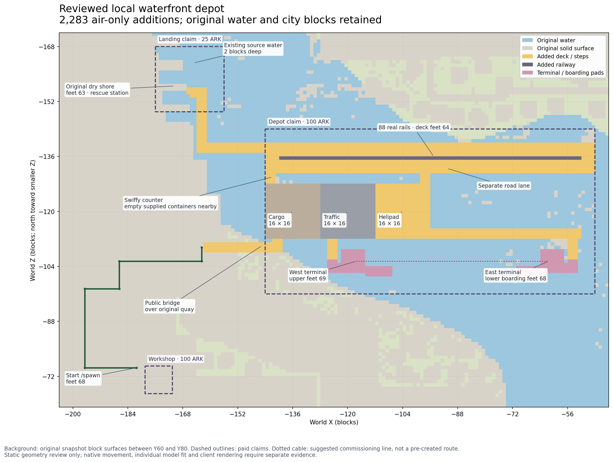

# Local workshop and waterfront depot

The optional `public_local_workshop_v1` profile supplies a small workshop, a larger waterfront depot and a natural water landing in the supplied public city copy. It exposes all **87 original vehicle profiles** and all **358 furniture entitlements** through their ordinary paid shops, with real facilities for road, water, air, rail, ropeway and specialist furniture use. This is an isolated laptop configuration. Its static geometry review and server mechanics evidence do not certify every model's native Java/Bedrock rendering or complete the wider Revision 4 game.

The builder applies this profile only when explicitly selected with `--local-playtest` and the exact public snapshot dated 2026-11-23. It refuses a private-server import, changed world, existing player/core state, an existing property registry, or a running world. The production configuration in the source JAR remains unchanged.

## Start playing

1. Extract the entire laptop ZIP and run `Start-GTM.bat` on Windows. Use your own compatible Minecraft client and accept the local server resource-pack prompt. The packaged launcher reports the Java loopback address and the selected current private IPv4 for Bedrock NetherNet; see [the connection guide](LAPTOP_BEDROCK_NETWORK_R4.md). The recorded owner EULA acceptance is preserved when that input was supplied; a package without existing acceptance asks its owner at first start.
2. Register or log in through the existing protected account workflow. Do not enter credentials in the server console. A new authenticated account receives the existing starter kit, ordinary starting balance, phone and one owner-bound traditional auto-rickshaw. The profile does not create accounts or edit balances.
3. New accounts arrive on the public corridor at **−181.5, 68, −74.5** in world `world`. `/spawn` returns to this same clear corridor. The workshop is immediately east; the food counter is west. No private parcel must be crossed to reach the food counter.
4. Open `/gtmproperty` or the phone's property app. Select **Local Workshop · 100 ARK playtest price** and make the ordinary paid purchase. This **100 ARK** price is specific to local playtesting. It is not a claim about the finished game's property economy. Ownership is recorded by the normal ledger transaction. The claim is a single 8×8 parcel, so another account cannot also buy it.
5. Use `/furniture shop` to purchase a piece. Open `/furniture`, select that owned piece, and follow its controls. A chair or other freestanding piece can be placed on clear floor inside the claim. A storage, cooking, bed, light, wash, power or loading-flap design first needs the matching real backing block described below. All placement, proximity, ownership, access and collision rules remain active.

The parcel contains blocks **x −179 through −172, y67 through y75, z −75 through −68**, including its brick floor at y67. The open public corridor at **x −182 through −180** remains outside the claim. Keep the surrounding oak-stair border clear. The 8×8 workshop is a small testing space; remove or rotate pieces through their controls when making room for another design. Larger furniture, coupled trains, cable machinery and traffic intersections use the separately purchased depot below.

## Local prices and capacity

Every original vehicle costs **1 ARK** in this explicit local profile. Furniture also costs **1 ARK**, except the magazine rack (**125 ARK**) and wheelchair (**75 ARK**), whose original demonstrated purchase costs are retained. The three properties cost 100, 100 and 25 ARK. Buying one of every furniture and vehicle model, all three properties and the original 20 ARK meal totals **888 ARK**, within the normal new account's existing 1,000 ARK balance. Fuel, recipes, equipment, outfits and subsequent service purchases still use their normal prices and actual supplied items. These are local playtest prices, not proposed production economics.

The ordinary ownership caps are 512 furniture pieces and 128 vehicles in this profile. The vehicle garage and service lists have pages. Only 32 vehicles may be loaded at once, and furniture's collision, nearby, chunk and global limits remain active. Use owned controls to remove or park pieces while retaining their original entitlement. Owning the catalog does not mean that all its bodies can occupy the same small area.

## Reach and buy the waterfront facilities

Use `/gtmproperty` to buy **Waterfront Depot · 100 ARK playtest price** and **Waterfront Landing · 25 ARK playtest price** when needed. The normal ledger records the purchases. Neither property is assigned to any account in advance; a bought property is no longer for sale to another account.

From the spawn corridor, the original paved pedestrian approach is clear at feet y68. Follow these turns, then cross the new three-wide half-step bridge over the existing quay:

| Turn | X / Y / Z |
|---|---|
| Spawn | −181.5 / 68 / −74.5 |
| West | −196.5 / 68 / −74.5 |
| North | −196.5 / 68 / −97.5 |
| East | −186.5 / 68 / −97.5 |
| North | −186.5 / 68 / −105.5 |
| East | −162.5 / 68 / −105.5 |
| Bridge entrance | −162.5 / 68 / −109.5 |

The survey checked every support and headroom cell along this 84-block approach. It is a pedestrian route; the city wall and fence beneath the raised bridge remain intact. The bridge descends to the depot deck at feet y64. A lower pier extends west from the railway and south to the original landing at feet y63.



| Facility | Bounds or useful position | Actual available geometry |
|---|---|---|
| Depot claim | x−144..−49, y61..160, z−144..−97 | One paid claim covering the bays, railway, service road, terminals and bounded flight volume |
| Cargo bay | x−144..−129, z−128..−113; feet y64 | One complete 16×16 chunk; empty barrels at −142/64/−125 and −142/64/−115 |
| Traffic bay | x−128..−113, z−128..−113; feet y64 | A complete clear 16×16 area with room for a 9×9 traffic cross |
| Helipad | x−112..−97, z−128..−113; feet y64 | A complete 16×16 pad; original air checked through y160 |
| Railway | x−140..−53, y64, z−136 | 88 connected east–west vanilla rails on a 96×9 pier |
| Road and service lane | x−139.5 to −59.5, y64, z−132.5 | Clear straight lane alongside the railway; keep vehicle bodies separate from rails and other parked models |
| Swiffy counter | −141.5 / 64 / −131.5 | Real counter beside the west road origin; separate from the original Zomatoo counter |
| West terminal pad | x−122..−116, z−109..−103; feet y69 | Real raised support, half-step stairs and lower boarding strip at feet y68 |
| East terminal pad | x−64..−58, z−109..−103; feet y69 | Matching support and boarding strip, connected by a ground walkway |
| Landing claim | x−176..−157, y60..70, z−168..−150 | Original water and cobblestone shore, reached by the lower public pier |
| Boat berth | x−168..−160, z−168..−158 | Two complete original source-water layers at y61 and y62; a dry exit remains on its west bank |
| Rescue station position | approximately −170.5 / 63 / −156.5 | Original dry shore beside source water; the lifebuoy ring moves the consenting swimmer on a bounded checked route |

Additional depot backings are a level-3 water cauldron at **−130/64/−114**, a dry LIGHT block at **−143/65/−119**, and a wall lever/lamp pair at **−141/64/−118** and **−140/64/−118**. The barrels begin empty. The cargo bay fits the ordinary same-chunk custody rules; it does not create supplies or cargo copies.

## Pushable carts and large festival structures

The [shopping cart nest](FURNITURE_SHOPPING_CART_R4.md) remains a fixed owned model. Its controls lend one cart component keyed to that original entitlement. Push the component on flat owned floor, then return it beside the same nest after fully unloading. The [nine original festival carts](FESTIVAL_CARTS_R4.md) move their original placed model directly. Their **Use** controls expose pushing and supplied cargo; `/furniture festivalcart push <UUID>` and `/furniture festivalcart park <UUID>` provide the same owner actions. Stay beside the cart, within reach and line of sight. W/S pushes or pulls, a released A/D input makes a cardinal turn, and sneak parks. Slabs, steps, other bodies and property boundaries remain real obstacles.

For actual cargo, buy and connect two owned storage models to the cargo bay's real barrels. Put real acquired items in one barrel and leave the other empty. Commission those furniture UUIDs through the cart's cargo controls, approach the source and start pickup. The source, destination and route must fit the same loaded owned chunk. The exact supplied contents stay in exclusive custody while the original cart or loan component physically travels. Approach the destination and unload once; if an interrupted output awaits verification, use **Verify** to inspect that existing output. The same paid items cannot also be accessed from the source. The existing lamp at **−140/64/−118** and bridge slabs at **z−114** need clear travel and owner approach paths; these carts do not climb the bridge stairs.

Large festival structures have their own [placement guide](FURNITURE_STRUCTURES_R4.md). Their geometry changes use the existing world floor and create no building blocks. The ordinary depot deck has feet height **y64**. A large original bandstand extends **3.2 blocks below its walkable top**, so it needs an actual raised floor with top **y67** at this depot, or another compatible owned site. For the reviewed stage center **(−120.5,63.8,−120)**, supply a real **13×6 floor** of blocks at **x−127..−115, y66, z−124..−119**; its top is y67. Build normal safe support and stairs using legitimately acquired blocks, and keep the complete **16×16 owned, loaded volume** clear for the original structure. Click the actual raised floor through ordinary placement. The local profile does not provide this raised stage floor or its stairs, and it does not fill the support volume automatically. Keep the traffic bay clear or remove its other models before repurposing it for a stage.

## Real workshop backing blocks

These are actual vanilla blocks in the copied world. Storage and processors begin empty. The profile supplies no food items, ingredients, fuel, purchased furniture, outfit entitlement, sign ownership or equipment. Use ordinary inventory items and purchases.

| Position, X/Y/Z | Actual backing | How to use it |
|---|---|---|
| −178 / 68 / −74 | Empty barrel | Connect a storage, disposal or cargo furniture piece. The same real inventory opens through the model. |
| −176 / 68 / −74 | Empty smoker | Connect a cooking design such as the tandoor, hob or oven tower. Supply actual fuel and a smoker-compatible ingredient. |
| −174 / 68 / −74 | Empty furnace | An additional vanilla processor for ordinary recipes; no fictional native-furniture binding is claimed. |
| −172 / 68 / −74 | Empty brewing stand | An additional vanilla brewing station with normal ingredient and fuel requirements. |
| −178 / 68 / −71 | Water cauldron, level 3 | Connect wash furniture. Its water changes through the actual cauldron interaction. |
| −176 / 69 / −71 | Dry LIGHT block, level 15 | Connect a lamp/light design. This invisible vanilla backing is targeted by the furniture light-binding tool. Its real light level follows the owned model's controls. |
| −174 / 68 / −71 | Wall lever | Connect power-control furniture. The lever is attached to the real redstone lamp immediately east at −173 / 68 / −71. |
| −172 / 68 / −71 | Dry oak trapdoor | Connect a loading-flap/bridge design; the real flap opens and closes. |
| −178 / 68 / −69 and −178 / 68 / −68 | Complete red bed, foot and head | Connect a bed design to either half. Actual sleep still follows the world's normal bed rules. |
| x −174 and −173, y68 through y70, z −68 | Two-column brick wall | Mount a two-tile owned sign on its north face, using the row at y70. Both wall blocks and the clear frame space are inside the claim. |

For a piece that needs backing, choose **Connect** in its furniture controls, then right-click the matching block within reach. Reopen the piece and choose **Place**, then right-click the top of a solid brick floor. The placed model must remain within four blocks of its backing. Its complete footprint must stay inside your claim and clear of other blocks, entities and furniture. Connecting a backing does not bypass those placement rules. Stand outside the intended footprint when placing it.

Use **Remove** to take a model out of the world while retaining ownership, then **Disconnect** when releasing its backing. Do not break a reserved backing to move furniture. Inventory contents remain in the real container; removal is not an item-copy operation.

## Food, vehicles, signs and phone

**Food:** Zomatoo's public counter consists of two smooth-stone blocks at **−185 / 68 / −73** and **−184 / 68 / −73**. Its collection point is **−184, 68, −72**, in the clear space in front. Swiffy uses the separate depot counter at **−141.5, 64, −131.5**. Use the brand's phone app or `/gtmfood zomatoo` or `/gtmfood swiffy`, choose a meal, review its price and pay. After preparation, collect within five blocks with a clear line of sight. Eating or drinking consumes the actual item and applies its supported hunger, saturation or fictional drink effects. Stock, debit, refund and queued delivery use the ordinary ledger.

**Auto-rickshaws:** `/car` opens the owned garage. The traditional auto comes from the existing one-time authenticated starter grant. `/car shop` offers the electric and cargo autos through normal paid purchases, along with the other original models. Use a broad, loaded and clear road surface, then the actual driver/passenger seats and vehicle controls. The small workshop and pedestrian corridor are not driving routes. Fuel/charge, condition, supported cargo, locks, keys and servicing remain real rules. All 65 road profiles use the shared road engine; the additional 22 profiles use their own transport/support modes. Shared runtime checks do not establish native rendering and fit for every body.

**Signs:** open `/gtmsigns`, choose one of the original designs, and create an owned display within the normal quota. Select **Place on your wall**, then the north face of the left tile at **−173 / 70 / −68**, viewed from the north. Its second tile extends west to x−174. Use the sign's controls to bind information, a real destination or an available service; scheduled artwork and public headlines use their actual stored settings. Local image uploads remain off in this profile.

**Phone, equipment and outfits:** `/phone`, `/equipment`, `/wardrobe` and `/gtmfinish` open their actual authenticated interfaces. Purchases use existing balances and prices. Native downed handling allows supported medical equipment to interact with real nearby downed players. Existing role, consent, proximity and payment checks remain active; the profile grants neither medic nor police authority. The builder refuses unreviewed extra plugins, including an external revive handler, to keep the pinned native recovery engine authoritative.

## Commission and operate transport normally

The local owner permission permits route work **only inside the configured depot or landing and only after the actor has bought the complete property being used**. A guest key, public staging setting or proximity to another owner's asset does not confer this authority. Full vehicle/passenger volumes, actual route geometry, loaded chunks, borders and ownership are checked again by the runtime. The profile creates no route, fleet assignment or NPC trip.

**Water and air:** buy the relevant model through `/car shop` while beside its real launch area. A useful boat pose is approximately **−164.8, 62.55, −163.2** with yaw0; the original west bank supplies a dry local exit. Use the helipad for aircraft delivery and landing. Board through the ordinary garage/seat controls and use normal player input. Air movement is bounded by the profile's y160 ceiling and ordinary property/collision checks. Land aircraft before servicing. Stop and leave vehicles through their ordinary controls; no destination teleport is supplied.

**Rail:** face along the real east–west rails and aim at a rail within eight blocks. Run `/car route scan depot_rail`. Buy an original `local_driving_cab` beside the scanned line; delivery aligns and binds it to the available route. If needed, `/car route bind <vehicle-UUID> depot_rail` binds an already aligned owned body. Board with `/car enter <vehicle-UUID>` and drive using player input. To assemble a consist, buy `local_motor` or `local_trailer` near a clear gap behind the stopped cab/tail, then use `/car route couple <coach-UUID> <leader-UUID>` while the affected vehicles are empty. The complete coupled bodies must fit the guide interval. `/car route uncouple <coach-UUID>` separates a stopped safe consist. Route start/stop commands control cable machinery, not a rail cab's throttle.

**Ropeway:** buy two original `skylink_terminal_machinery` models on the raised pads. Suggested centers are **−117.5, 69, −105.5** and **−61.5, 69, −105.5**. The west purchase approach is **−120.5, 69, −105.5**, facing east; the east approach is **−58.5, 69, −105.5**, facing west. Inspect the ordinary delivery preview/space checks. Create the checked route with `/car route cable depot_cable <west-terminal-UUID> <east-terminal-UUID>`. Buy an original `skylink_cabin` beside the usable suspended line and bind it with `/car route bind <cabin-UUID> depot_cable` when necessary. The terminal anchor is y70.625, and the ordinary cabin pose is approximately y67.7108. The lower boarding strips at feet y68 provide safe local exits. Use `/car route start depot_cable` or `/car route stop depot_cable` within eight blocks of a terminal. The grip assembly requires an existing cable; after buying one, a new checked route may include its UUID between the terminal UUIDs. Machinery and cabins remain distinct original paid entitlements.

**Taxi:** buy and park an owned passenger road vehicle aligned with the straight depot lane. Explicitly opt it in with `/car fleet offer <vehicle-UUID> taxi`. Stand at its actual route origin and run `/taxiroute start depot_taxi East pier`, walk the lane and record `/taxiroute mark` every 0.2–8 blocks, then `/taxiroute finish <vehicle-UUID>`. The vehicle must remain within 0.75 blocks of the recorded origin, facing the first segment within60 degrees. Return to the origin, open the taxi app, review the real route/fare, pay and board. A real managed driver moves the reserved body only after boarding; cancellation stops it at its current position.

**Courier:** use an original scooter-category vehicle beside the Swiffy counter, aligned at a clear road origin within six blocks of the collection point. Run `/car fleet offer <scooter-UUID> courier`, then `/foodroute start depot_delivery swiffy`. Walk continuously along the clear road to a delivery stop and run `/foodroute finish`. This survey records actual player motion; teleporting during it invalidates the route. Use normal food ordering to request the commissioned stop. The existing stock, preparation, service fee, physical scooter/NPC travel, recipient handoff and cancellation/refund rules all remain active. A purchased vehicle is never silently volunteered for either service.

Fuel/repair sites are installed for each mode: road at **−133.5/64/−132.5**, water at **−170.5/63/−162.5**, air at **−104.5/64/−120.5**, rail at **−132.5/64/−134.5**, and ropeway/support at **−120.5/69/−105.5**. Stand within eight blocks of the owned stopped vehicle, with both player and vehicle within16 blocks of its appropriate station. Furniture can also expose real service anchors where its backend supports them. The phone and service menus explain unavailable routes, required roles or missing supplies without inventing completed work.

## Exact changes and rollback

The helper rechecks all 498 files in the public snapshot against the extracted copy, verifies every parcel/counter/corridor floor and air cell, and checks saved entities. The original19 workshop cells and **2,283 depot cells replace exact air only**. Original water, shore, city blocks, wall, fence and entity records remain intact. Replacement chunks are appended to the existing region; original compressed chunk bytes, timestamps, unrelated chunk pointers, block entities, structures, biomes and scheduled ticks are retained. Six empty block entities supply the three barrels, smoker, furnace and brewing stand. The actual waterfront chunks include valid empty TAG_End lists; the patch preserves them unless a real backing is appended, when it emits a compound list. In the pinned Paper26.3 target, beds are ordinary two-part block states with no `minecraft:bed` block entity. Changed chunks invalidate lighting and height maps for normal reconstruction.

The helper writes only the copied region, copied core configuration/runtime sites, ordinary Bukkit permission defaults and local guide. Its added defaults are `gtm.food`, `gtm.food.fictional-alcohol`, `gtm.properties`, `gtm.finishes` and the narrowly gated `gtm.vehicles.owner-commission`. It grants no administrator, operator, staff survey, fleet manager, police, medic, authentication-enrollment or public-furniture override. The source archive, EULA, online/offline UUID policy, account files, financial state and live Daytona server remain untouched.

`local-playtest-backup/manifest.json` records source and before/after hashes, checked geometry, every exact changed block state, ordinary permissions, price overrides and all three paid property definitions. Complete original managed files remain under `local-playtest-backup/originals/`. The independent source survey is [PUBLIC_WORLD_DEPOT_SURVEY_R4.json](reports/PUBLIC_WORLD_DEPOT_SURVEY_R4.json); its reviewed preimage/postimage digest is `c57e3b200bb2061c6509408ef15ac0be9b67142fb224acf3e9d814eec7247302`.

Before first server start, the developer tool can restore those exact before images:

```sh
python tools/local_playtest_profile.py /absolute/path/to/new/laptop-server --rollback
```

Rollback refuses any new core/account state, new world file, changed world byte or changed managed configuration. Once the world has been played, use an ordinary full-server backup and a reviewed save migration. Restoring the original region over a played world would erase later progress, so this helper does not do that. The backup is retained after rollback for inspection.

## Verification boundaries

`tools/test_local_playtest_profile.py` exercises the real pinned world, exact state/property/price readback, preservation of unrelated snapshot members and block entities, private/changed-world refusal, account-state refusal, world lock refusal, external-revive refusal, exact rollback and refusal after progress. `tools/test_local_playtest_depot.py` checks the actual authored cable and ferry bounds against the proposed structures, complete bays, rails, road and local exit geometry. The source survey can be reproduced without writing the world:

```sh
python tools/survey_laptop_depot.py /path/to/EXPECT_SDCRAFT_PUBLIC_WORLD_2026-11-23.zip \
  docs/reports/PUBLIC_WORLD_DEPOT_SURVEY_R4.json \
  --preview docs/reports/PUBLIC_WORLD_DEPOT_LAYOUT_R4.png
```

The actual Paper profile report proves the original ordinary paid workshop/food/sign flow. The fresh ordinary account passed 24 workshop checks, the complete 22-step wheelchair scenario and six real protocol-input checks. Expanded depot acceptance then completed paid claims, original road/water/air/rail/cable entitlements and actual controlled travel. Its initial 65 passing checks and one test-client stale-passenger failure are retained; the separate 20-check continuation completed the actual paid taxi and physical courier without resetting the account. [LAPTOP_DEPOT_R4_EVIDENCE.json](reports/LAPTOP_DEPOT_R4_EVIDENCE.json) links both exact reports and distinguishes real input packets from setup positions.

The unchanged packaged launcher subsequently passed ten reconnect checks with no probe plugins installed, retaining the bank at 50428 cents and the paid assets, ordinary permissions and actual GPS/map interfaces. See [PACKAGED_LAUNCHER_RESTART_R4_EVIDENCE.json](reports/PACKAGED_LAUNCHER_RESTART_R4_EVIDENCE.json). The newer [shopping cart guide](FURNITURE_SHOPPING_CART_R4.md) documents use of this same depot's supplied barrels; its specialist acceptance is tracked separately from the original launcher checkpoint.

Server mechanics probes that inject events or use setup teleports are labeled as such. Native client rendering, each model's visual fit, Bedrock input and Windows execution remain separate qualifications. A pass on the shared engine does not certify every original model's geometry or every unsurveyed city location.
